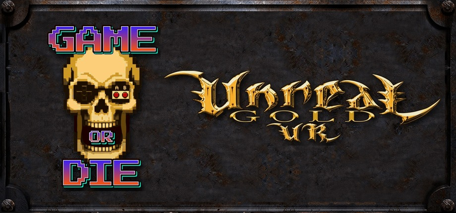

# Unreal Gold VR

[Install](#install) · [Standalone](#standalone-on-meta-quest-3) · [Playing](#playing) · [FAQ](#faq) · [Known issues](#known-issues)

Unreal Gold (Unreal and Return to Na Pali) in virtual reality: real stereo, head tracking, and the gun in your hand. On PC VR, or standalone on a
Meta Quest 3 or a Steam Frame, with online play where PC and headset players meet on the same
server.

No game content is included. Epic made Unreal Gold free, so you don't need to own it: with no
copy, Setup gets it for you.

## Install

1. Download **Unreal Gold VR Installer.exe** from [Releases](../../releases) and double-click it.
   (Windows may say it protected your PC: choose More info, then Run anyway. The installer is not
   code-signed.)
2. Press **INSTALL**.
3. Connect your headset, then press the big button again (now **PRESS START**), or start
   **Unreal Gold VR** from the desktop or from Steam.

### Installing by hand

1. Download `Unreal-Gold-VR-1.0-PCVR.zip` from [Releases](../../releases), unzip it anywhere and
   double-click **Setup.bat**. It finds your Unreal Gold by itself (every Steam library, GOG and the usual folders) and adds
   OldUnreal's **227k** patch if your copy does not have it yet. With no copy on your PC, it
   downloads the Unreal Gold CD from the Internet Archive and the patch from OldUnreal's GitHub (about 800 MB, both checked against their published checksums) and puts the game in
   `C:\Games\Unreal Gold`. If you have the game somewhere Setup does not look, drag its folder onto
   Setup.bat.
2. Start your headset's runtime: **Virtual Desktop**, **Meta's PC app** (Link, Air Link) or **SteamVR**. **Steam Frame:** start SteamVR and put the Frame on first; the game sees SteamVR
   running and uses it, whatever your PC's OpenXR runtime is set to.
3. Start **Unreal Gold VR** from your desktop or from Steam.

Setup makes a `VR` folder inside your game folder for the VR settings and logs. Your normal
Unreal Gold and its settings are not changed, and it still starts on the monitor as always.
**Updating keeps your saves and settings:** run the installer or Setup again to update, and your
saved games, VR settings, gun fits and Game Tome notes stay as they are. **Uninstall.bat** in the
`VR` folder removes everything Setup added and keeps your VR settings for next time, and
**Collect logs.bat** there puts the logs in one zip on your desktop for a bug report.

While you play in the headset, the monitor shows the observer view (what you see, held steady,
for streams and recordings) across the whole screen. Alt+Enter turns it into a window and back.

If the game starts on the monitor instead of the headset, its log (`VR\Unreal-VR.log`) has one
line beginning `RUNNING FLAT` that says why. An OpenXR add-on (an API layer) that will not load
stops every OpenXR game on the PC; the game switches broken ones off for itself and lists them
in the log, and fredemmott's OpenXR API Layers GUI turns them off for good.

## Standalone on Meta Quest 3

Unreal Gold VR also runs on the Quest 3 by itself, with no PC while you play.

1. Download `Unreal-Gold-VR-1.0-Quest.zip` from [Releases](../../releases) and unzip it on your PC.
2. Turn the headset on, plug it into the PC with a USB-C cable, and double-click **Setup.bat**.
   The first time, put the headset on and choose Allow.
3. On the headset: Library, Unknown Sources, **Unreal Gold VR**.

It plays your Unreal Gold (Steam, GOG or the disc), both Unreal and Return to Na Pali, as
version 226, so it joins the same servers as the PC version. With no copy on the PC, or one
with the 227 patch, Setup takes the original files from the Unreal Gold CD image at the
Internet Archive (650 MB, checked). Nothing is mounted.
The headset needs Developer mode, turned on once in the Meta Horizon phone app; the Quest
download's README walks through it. Run Setup again after an update: it copies only what changed
and keeps your saved games and settings, with a copy of them on the PC.

## Standalone on Steam Frame

The Quest download also runs on a Valve Steam Frame with no PC, in the Frame's own library.

1. On the Frame, once: Settings, System, Enable Developer Mode; Settings, Developer, Set User
   Password; and install Lepton from the Store.
2. With the Frame on and on the same home network as the PC, double-click
   **Setup Steam Frame.bat**. The first time, it pairs with the Frame: on the Frame, Settings,
   Developer, Pair new host, then Accept.
3. On the Frame: Library, **Unreal Gold VR**.

It runs at 90 Hz with 4x anti-aliasing.

## Standalone on Meta Quest 3

Unreal Gold VR also runs on the Quest 3 by itself, with no PC while you play.

1. Download `Unreal-Gold-VR-1.0-Quest.zip` from [Releases](../../releases) and unzip it on your PC.
2. Turn the headset on, plug it into the PC with a USB-C cable, and double-click **Setup.bat**.
   The first time, put the headset on and choose Allow.
3. On the headset: Library, Unknown Sources, **Unreal Gold VR**.

It plays your Unreal Gold (Steam, GOG or the disc), both Unreal and Return to Na Pali, as
version 226, so it joins the same servers as the PC version. With no copy on the PC, or one
with the 227 patch, Setup takes the original files from the Unreal Gold CD image at the
Internet Archive (650 MB, checked). Nothing is mounted.
The headset needs Developer mode, turned on once in the Meta Horizon phone app; the Quest
download's README walks through it. Run Setup again after an update: it copies only what changed
and keeps your saved games and settings, with a copy of them on the PC.

## Standalone on Steam Frame

The Quest download also runs on a Valve Steam Frame with no PC, in the Frame's own library.

1. On the Frame, once: Settings, System, Enable Developer Mode; Settings, Developer, Set User
   Password; and install Lepton from the Store.
2. With the Frame on and on the same home network as the PC, double-click
   **Setup Steam Frame.bat**. The first time, it pairs with the Frame: on the Frame, Settings,
   Developer, Pair new host, then Accept.
3. On the Frame: Library, **Unreal Gold VR**.

It runs at 90 Hz with 4x anti-aliasing.

## Playing

- **Your right hand is the gun.** Shots go where it points, and the game's own crosshair
  sits there, on the gun's aim, not in the middle of your view.
- **In menus, point and pull the trigger.** The menu hangs in front of you over the paused
  level, fixed in the room.
- **Walk where you look** with the left stick, turn with the right. In water you swim where you look too, up and down included, so the gun is free to aim.
- **VR Options** are at the top of the game's **Options** menu: a short first page, then
  turning and moving, your body and room, hands and weapons, controls, and the menu and
  monitor. Changes apply at once.
- **Recenter:** squeeze both grips together (in play or in a menu), or hold the Meta button, or
  use VR Options.
- **The monitor** shows a steady, level view for streams and recordings: it follows your
  turns but not the small movements of your head. VR Options can switch it to the plain eye.
- **Photo mode:** with the menu open, click the left stick to hide the menu and HUD for a
  screenshot; click again to bring them back.
- **Game Tome:** VR Options > VR > Game Tome opens the original manuals (Unreal and Return
  to Na Pali) as a book in your other hand, with pages for the VR controls and options at the
  front and a notebook at the back you write in with the gun hand. B, Y or the menu button closes it.
  Both palms up together, as you hold an open book, for a second opens it too, in play or in a menu.
- **Calibration room:** VR Options > Calibration > Fit the gun to your hand. A board stands in
  front of you with three dots. Aim the gun at each dot the way you would shoot it and pull the
  trigger: that sets where your shots go. Then the trigger fires test shots that leave marks on
  the board, and a flick of a stick moves the shots half a degree. Hold the grip and the gun stays
  where it is; move your hand until the handle sits in your palm, and let go to save. The barrel
  always points where your shots go, and the red line starts at the muzzle. Your first gun's fit is
  where every gun starts, and each gun you change after that keeps its own fit. B undoes the last change,
  holding B puts it back to normal. A shows the next gun: every gun in the game is there, found
  yet or not. Each kind of controller keeps its own fit, and you leave holding the gun you came
  in with.
- **Rifle scope:** a rifle's zoom (alt-fire) shows in a round scope on your aim, magnified as
  far as the game zooms, and the rest of your view stays as it is.

| Controller | Does |
|---|---|
| Right trigger | fire |
| Left trigger | alt-fire |
| A | jump |
| B | duck |
| X | next weapon |
| Left stick | move |
| Left stick click | the Translator (messages and hints) |
| Right stick | turn (smooth, or in steps: VR Options) |
| Left menu button | game menu |
| Both palms up together (a second) | the Game Tome |

Other controllers get the same jobs on their nearest buttons. On the Steam Frame, X and Y are
the left D-pad's down and up, and the game menu is View or D-pad left. On Valve Index, left A is X
and left B is the game menu. On HTC Vive, the trackpads move and turn and the right menu button
jumps.

A, B, X, Y and the stick clicks can each be given another job on VR Options' Controls page,
which also puts them back. The triggers, grips, sticks and menu button are fixed.

## VR Options

| Page | Settings |
|---|---|
| VR | recenter, snap turn, Leftorium, crouch for real |
| Turning and Moving | snap turn, smooth turn speed, movement speed, walk where you look or where you aim, comfort vignette, swap sticks, dodge with a double flick (off: the stick never dodges), head bob (off), smooth snap turn (a snap sweeps round instead of jumping) |
| Your Body and Room | recenter, crouch for real (duck in your room and you duck in the game), fade in walls, world size (how big the world feels), walk around your room (on: walk in your room and you walk in the game) |
| Hands and Weapons | Leftorium (left-handed), weapon size, the game's crosshair on the gun, red aim dot instead and its size, laser beam, vibration, weapon tuner, rifle scope and its size |
| Controls (Touch) | what A, B, X, Y and the stick clicks do; reset to defaults |
| Menu and Monitor | menu size, damage and pickup flash, steady desktop view, HUD in the room (it follows you instead of your head), render quality (sharper or faster), anti-aliasing (smooths jagged edges); both take effect at the next start |
| Calibration | fit the gun to your hand (the calibration room), reset calibration, which controller you have if it guessed wrong |

Crouch for real, fade in walls and vibration are off to start with.

The **weapon tuner** fits each gun in your hand, from the keyboard while you wear the headset:
arrows and PgUp/PgDn adjust, End changes mode (move, angle, size), Home changes the step,
Insert resets that gun. Fits are saved per weapon in `UnrealVRWeapons.ini`.

Every setting is also in `VR\Unreal-VR.ini` (in the game folder) under `[UnrealVR.VRGameEngine]`.

## Playing online

Multiplayer, Find Internet Games opens the server browser on Favorites, where the Game Or Die
server is waiting. PC, Quest 3 and Steam Frame players all play there together. In VR the
browser fills the menu screen. New game: Game, New Game, then Unreal or Return to Na Pali.

## FAQ

- **Is it free?** Yes, and it always will be.
- **Do I need my own copy of the game?** No. Epic made Unreal Gold free, and Setup gets it for
  you. If you have it (Steam, GOG or the disc), Setup uses yours.
- **Which headsets work?** On PC: Virtual Desktop, SteamVR (Steam Link, the Steam Frame, Valve
  Index, HTC Vive, Windows Mixed Reality), and Quest Link or Air Link. Quest Link and Air Link work with Meta's own PC app or through SteamVR.
- **Standalone?** Yes: Quest 3 and Steam Frame, from the Quest download.
- **Multiplayer?** Yes, online on the Game Or Die server, PC and headset players together.
- **Are my saves safe?** Yes. Setup never touches your saved games or settings, and updating
  keeps them.
- **What PC do I need?** It was played on an RTX 5080 and an RTX 4070 Ti SUPER at the headset's
  full 90 Hz. On a weaker PC, set VR Options, Menu and Monitor, Render quality to Faster.
- **Left-handed?** Yes: turn on the Leftorium in VR Options.
- **It started on the monitor, or something broke:** the log (`VR` folder) has a line beginning
  `RUNNING FLAT` that says why. Run **Collect logs.bat** and send the zip to us on
  [Discord](https://discord.com/invite/tZdccWFpAc) with a line on what happened.

**Tested on:** Meta Quest 3 over Virtual Desktop and the Steam Frame over SteamVR (PC), and
Meta Quest 3 and Steam Frame standalone. Valve Index, HTC Vive and Windows Mixed Reality
controllers are supported but not yet tested by us.

## Known issues

- Menus are the game's own flat menus on a panel: readable and clickable, not built for VR.
- Online, walking around your room moves your player through the game's own movement, so the
  server agrees where you stand; it follows a moment behind your head.
- Servers that run anti-cheat are not tested.

## License and credits

Unreal Gold VR is a Game Or Die project. Free to download and use; you may share the download
unchanged, but not sell it or publish changed copies as your own (`LICENSE.txt`).

Unreal Gold by Epic Games and Digital Extremes. It runs on OldUnreal's
[227k patch](https://github.com/OldUnreal/Unreal-testing), and the PC renderer is a fork of OldUnreal's
[XOpenGLDrv](https://github.com/OldUnreal/XOpenGLDrv) (BSD 3-Clause). The standalone version runs
Unreal Tournament's own 1999 engine, brought to Android by Andiweli's
[UT99-Android](https://github.com/Andiweli/UT99-Android). Every part by others and its license is
in `CREDITS.txt` (PC) and `THIRD-PARTY.txt` (standalone).

Thanks to the OldUnreal team for keeping the engine alive, GHWST for the Quest ports, and Team
Beef ([teambeefvr.com](https://www.teambeefvr.com/)), whose VR ports set the pattern.

This is a fan project, not affiliated with or endorsed by Epic Games or OldUnreal.

---

**Get an email when the next port ships:** follow [Game Or Die on Patreon](https://www.patreon.com/cw/GameOrDie) for free. Ports are never paywalled.
